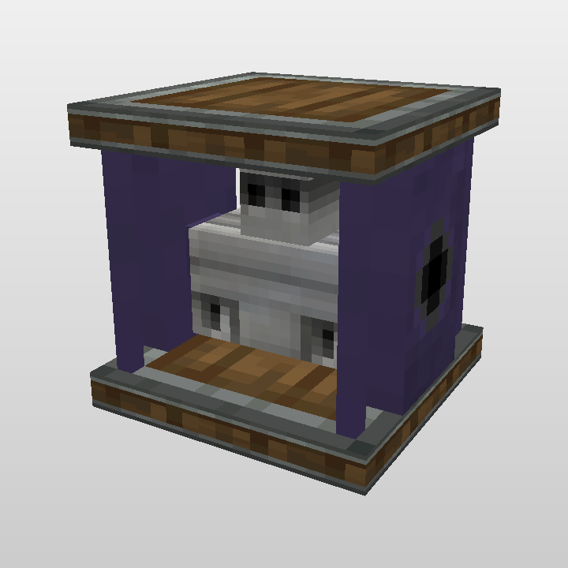

# 神秘动力学（Mystery Dynamics）

为「神秘时代」移植版添加联动 **机械动力（Create）** 的设备。NeoForge 1.21.1 / Create 6.0.x。

## 傀儡动力系统

8 台不同材质的傀儡动力系统，都是应力源；另有 1 个纯装饰的空框架。转速 / 容量按「傀儡动力设计」配置：

| 方块 | 转速 | 应力容量 | 每 RPM 容量 |
|---|---|---|---|
| 稻草傀儡动力系统 | 160 RPM | 128 SU | 0.8 |
| 木头傀儡动力系统 | 128 RPM | 256 SU | 2.0 |
| 血肉傀儡动力系统 | 160 RPM | 384 SU | 2.4 |
| 粘土傀儡动力系统 | 128 RPM | 512 SU | 4.0 |
| 油脂傀儡动力系统 | 256 RPM | 128 SU | 0.5 |
| 石头傀儡动力系统 | 64 RPM | 1024 SU | 16.0 |
| 铁卫傀儡动力系统 | 32 RPM | 2048 SU | 64.0 |
| 神秘傀儡动力系统 | 128 RPM | 4096 SU | 32.0 |
| 空傀儡动力系统框架 | — | — | 纯装饰，无作用 |

输出轴与正面垂直：`facing=north/south` 时东、西两面是输出端，`facing=east/west` 时南、北两面是输出端。



## 操作

| 操作 | 效果 |
|---|---|
| **手持扳手**右键顶面/底面 | 旋转整机朝向 90°，应力输出端跟着转到另外两面 |
| **手持扳手**右键侧面 | 翻转输出转向（顺时针 ⇄ 逆时针），动作栏提示当前方向 |
| 空手右键 | 不改变转向 |
| 潜行 + 扳手 | 拆除 |

**放置对齐**：放下设备时自动检查输出轴两端相邻传动部件的转向；如果对面是逆时针，新设备直接以相同转向接入，避免一正一反的冲突。

**转向联动**：同一传动网络里所有傀儡动力系统会一起翻转转向（参考蒸汽引擎的 `movementDirection`）。

## 挖掘与掉落

- 硬度与石头一致（1.5），爆炸抗性 6.0；
- 同时登记在 `mineable/axe` 和 `mineable/pickaxe` 里，**斧头或镐**都能正常挖掘并掉落方块本身；
- 潜行 + 机械动力扳手仍然可以直接拆卸（保留原有行为）。

## 构建

需要 JDK 21，以及 Create 6.0.10 的 4 个编译依赖（放在 `libs/`，见 [libs/README.md](libs/README.md)）。

```powershell
.\gradlew.bat build
```

产物：`build/libs/神秘动力学-<version>.jar`。

> 如果访问不了 Mojang / NeoForge 官方源，`gradle/mojang-mirror.gradle` 会把仓库切到镜像；网络正常时可以删掉 `build.gradle` 里的 `apply from` 一行。

## 项目结构

```
src/main/java/com/mysterydynamics/
  MysteryDynamics.java                 模组入口、9 个方块的注册、应力值注册
  block/GolemPowerBlock.java           应力源方块（朝向、输出面、扳手交互、放置对齐）
  block/GolemPowerBlockEntity.java     转速 / 容量读取、转向联动
  block/GolemPowerFrameBlock.java      空框架（纯装饰）
src/main/resources/assets/mystery_dynamics/
  blockstates/  models/  textures/  lang/   9 套方块 / 物品模型与贴图
src/main/resources/data/
  mystery_dynamics/loot_table/blocks/  9 个掉落表
  minecraft/tags/block/mineable/pickaxe.json
model/
  *.bbmodel                          9 个 Blockbench 源文件
  textures/                          8 种傀儡材质 + 安山机壳 + 占位符
tools/
  preview_block.py                   方块模型预览渲染
  rcon_test.py                       开发服务器 RCON 冒烟测试
```

## 已做的验证

开发服务器 + RCON 实测（每台单独放置）：

| 方块 | Speed | Network.Capacity |
|---|---|---|
| 稻草 | 160.0 | 128.0 |
| 木头 | 128.0 | 256.0 |
| 血肉 | 160.0 | 384.0 |
| 粘土 | 128.0 | 512.0 |
| 油脂 | 256.0 | 128.0 |
| 石头 | 64.0 | 1024.0 |
| 铁卫 | 32.0 | 2048.0 |
| 神秘 | 128.0 | 4096.0 |

空框架放置后没有方块实体（纯装饰），符合设计。

## 说明

- 方块模型由 9 个 bbmodel 转换：读取元素的 `inflate`（负值内缩）、`display`（手持/GUI 变换），UV 按 128 工程分辨率除以 8。
- 「神秘傀儡动力系统」使用其专属 bbmodel 与 `golem_thaumium` 贴图。
- 目前没有为输出轴注册旋转渲染（BER），模型本身是静态方块；相邻的 Create 传动轴会自己渲染到方块表面。
- 配方暂未添加。
